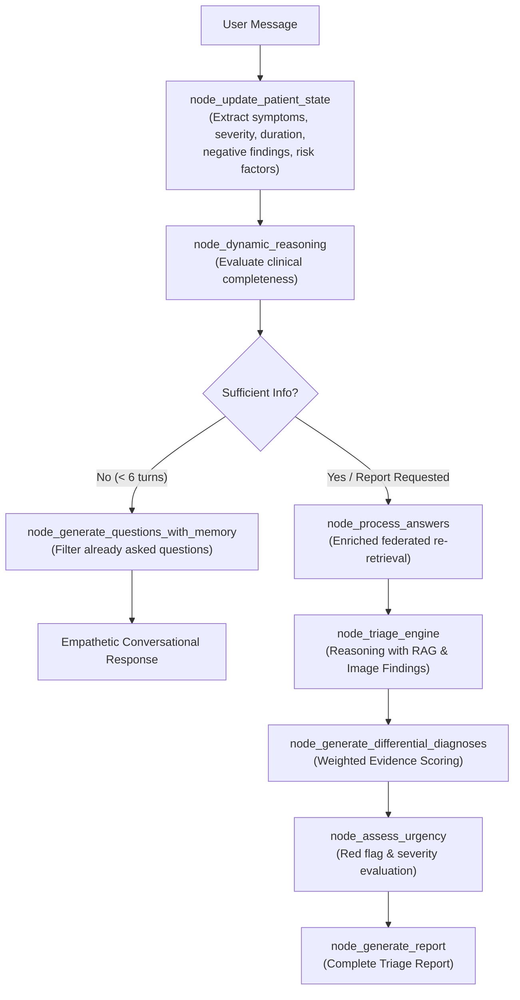

# MediSA — AI Medical Triage, Federated RAG & Healthcare Assistant Platform

[](https://www.python.org/)
[](https://fastapi.tiangolo.com/)
[](https://github.com/langchain-ai/langgraph)
[](https://github.com/facebookresearch/faiss)
[](https://www.php.net/)
[](https://www.mysql.com/)
[](https://youtu.be/N8_rTYncw5M)

**MediSA** (also referred to as **MediAI**) is an intelligent, full-stack medical decision-support and healthcare triage platform designed to address early-stage pre-consultation confusion and healthcare access bottlenecks in Bangladesh.

The platform combines **LangGraph conversational orchestration**, **multi-turn patient state tracking**, **weighted differential diagnosis ranking**, **supportive computer vision for skin/wound symptoms**, **automated prescription OCR**, and an advanced **Federated Retrieval-Augmented Generation (FRAG)** research architecture that compares traditional centralized retrieval against privacy-preserving, multi-hospital federated retrieval.

---

## 🎬 Video Demo

[](https://youtu.be/N8_rTYncw5M)

> 📺 **Watch the Walkthrough:** [MediSA — Intelligent Health Assistant Demo on YouTube](https://youtu.be/N8_rTYncw5M)

---

## Key Highlights & Innovations

1. **Multi-Turn Conversational Triage with Memory**
   - Empathic medical companion flow (`/process-message`) preserving session history.
   - **`PatientStateManager`**: Tracks symptoms, severity, onset, duration, negative findings (explicitly absent symptoms), risk factors, exposure history, and past medical history.
   - **Question Deduplication**: Memory-aware question filtering ensures the AI never repeats questions already asked or answered.
   - **Diagnostic Ranking Engine**: Multi-factor differential diagnosis scored across positive findings, ruled-out conditions, and clinical guidelines.

2. **Federated Retrieval-Augmented Generation (FRAG)**
   - Simulates independent hospital data partitions across major Bangladeshi institutions (Dhaka Medical College Hospital, Square Hospital, Evercare Hospital Dhaka, BIRDEM General Hospital, Dhaka Shishu Hospital, Labaid Specialized Hospital, plus National Reference guidelines).
   - Queries each hospital partition independently without centralizing or sharing private hospital records.
   - Fuses evidence using **passage deduplication**, **source weighting**, and a hybrid **semantic (cosine) + lexical reranker**.

3. **Empirical Retrieval Evaluation Framework**
   - Built-in retrieval benchmark (`retrieval_benchmark.json`) measuring **Precision@K**, **Recall@K**, **Reciprocal Rank (MRR)**, **NDCG@K**, **Hit Rate@K**, and **Latency (ms)**.
   - Interactive Research Evaluation dashboard (`frontend/pages/research-evaluation.html`) comparing Traditional RAG vs. FRAG live on arbitrary queries and standardized test suites.

4. **Multi-Modal Vision-Assisted Symptom Review**
   - Supportive image analysis of visible skin concerns (rashes, cuts, wounds, burns, swelling, pus, and irritation).
   - Integrates with Gemini Vision (`gemini-2.5-flash-lite`) with a local heuristic fallback when vision API keys are not supplied.
   - Incorporates visual findings into the LangGraph triage reasoning and patient report while adhering to strict safety disclaimers.

5. **Medical Document Analysis & OCR**
   - Ingests prescription PDFs and scans (via `pdfplumber` and `pytesseract`).
   - Extracts prescribed medications, dosages, frequencies, and durations directly into an active patient medication reminder schedule.

6. **Context-Aware Doctor & Hospital Recommendation**
   - Matches patients to specialists and hospital facilities based on inferred clinical condition, location, availability, and doctor experience.

---

## Architecture Overview

```
                          ┌───────────────────────────────────────┐
                          │   Frontend (HTML5 / Bootstrap / JS)   │
                          │   • Patient Dashboard & Symptom Chat  │
                          │   • Reports, Doctors, Appointments    │
                          │   • Document Upload & OCR Viewer      │
                          │   • Live FRAG Research Evaluation     │
                          └───────────────────┬───────────────────┘
                                              │ REST / AJAX
                     ┌────────────────────────┴────────────────────────┐
                     ▼                                                 ▼
     ┌───────────────────────────────┐                 ┌───────────────────────────────┐
     │   PHP Application Backend     │                 │   FastAPI AI Microservice     │
     │   (Port 8080 / Apache / Nginx)│                 │   (Port 8000 / Python 3.10+)  │
     ├───────────────────────────────┤                 ├───────────────────────────────┤
     │ • Authentication & Sessions   │                 │ • LangGraph Triage Pipeline   │
     │ • Patient Health Profiles     │                 │ • Patient State Manager       │
     │ • Triage Reports & History    │                 │ • Diagnostic Ranking Engine   │
     │ • Doctor Directory & Bookings │                 │ • Doctor Recommendation Route │
     │ • Medication Schedules        │                 │ • Document OCR Extraction     │
     │ • Secure Document Storage     │                 │ • Vision Analysis (Gemini)    │
     │ • MySQL Database (mediai_db)  │                 │ • Research Evaluation Router  │
     └───────────────────────────────┘                 └───────────────┬───────────────┘
                                                                       │
                                      ┌────────────────────────────────┴────────────────────────────────┐
                                      ▼                                                                 ▼
                    ┌───────────────────────────────────┐             ┌───────────────────────────────────┐
                    │       Traditional RAG Store       │             │       Federated RAG (FRAG)        │
                    ├───────────────────────────────────┤             ├───────────────────────────────────┤
                    │ • Combined FAISS Vector Store     │             │ • Simulated Hospital Partitions:  │
                    │ • Global flat index (mediai.faiss)│             │   - DMCH, Square, Evercare,       │
                    │ • sentence-transformers           │             │     BIRDEM, Shishu, Labaid        │
                    │   (all-MiniLM-L6-v2)              │             │ • National Reference Store        │
                    │ • Combined CSV datasets           │             │ • Federated Retriever             │
                    │   (symptoms, diseases, doctors,   │             │ • Reciprocal Fusion & Deduping    │
                    │    hospitals, severity weights)   │             │ • Hybrid Semantic/Lexical Rerank  │
                    └───────────────────────────────────┘             └───────────────────────────────────┘
```

---

## Project Structure

```
MediSA/
├── .env.example                       Template for environment variables
├── .gitignore                         Git ignore configuration
├── ARCHITECTURE.md                    Detailed image upload & triage architecture
├── README.md                          Project documentation & developer guide
├── requirements.txt                   Root Python dependencies
├── test_enhancements.py               Comprehensive unit test suite for patient state & diagnostics
│
├── database/
│   └── schema.sql                     Complete MySQL schema, tables, foreign keys & seed data
│
├── backend_php/                       PHP application layer
│   ├── api/
│   │   ├── appointments.php           Appointments booking and management API
│   │   ├── dashboard.php              Patient dashboard statistics API
│   │   ├── medications.php            Medication schedules & active reminder API
│   │   ├── reports.php                Triage reports CRUD & image analysis store
│   │   └── upload.php                 Medical document file upload & metadata API
│   ├── auth/
│   │   ├── login.php                  User login with bcrypt password verification
│   │   └── register.php               User registration & health profile creation
│   ├── includes/
│   │   └── config.php                 Database PDO connection & CORS response helpers
│   ├── migrations/
│   │   ├── add_image_analysis_to_reports.sql
│   │   └── add_report_image_path_to_reports.sql
│   └── uploads/                       Local storage for uploaded files (gitignored)
│
├── fastapi_ai/                        Python AI microservice
│   ├── main.py                        FastAPI application entry point & router mounting
│   ├── workflow.py                    LangGraph multi-step triage & report workflow
│   ├── requirements.txt               FastAPI service dependency specifications
│   ├── models/
│   │   ├── diagnostic_engine.py       Multi-factor differential diagnosis ranking
│   │   ├── llm_client.py              Groq (Llama-3/GPT-OSS) & Gemini API wrappers
│   │   ├── patient_state.py           Structured patient state definitions & schemas
│   │   ├── schemas.py                 Pydantic request & response data models
│   │   └── state_manager.py           State transitions, memory & question deduplication
│   ├── prompts/
│   │   └── templates.py               Medical prompts (intake, triage, reasoning, explanation)
│   └── routes/
│       ├── doctors.py                 Doctor recommendation & matching endpoints
│       ├── documents.py               Prescription & lab document OCR analysis
│       ├── evaluation.py              Research evaluation: Traditional RAG vs. FRAG
│       ├── symptom_images.py          Supportive rash/cut/wound image analysis
│       └── triage.py                  Conversational turn & report generation endpoints
│
├── rag_pipeline/                      Dual RAG retrieval & evaluation engine
│   ├── build_index.py                 CLI script to build traditional & federated indexes
│   ├── evaluation.py                  Benchmark execution & retrieval metrics calculations
│   ├── federated_retriever.py         Multi-hospital federated retriever implementation
│   ├── frag_engine.py                 High-level FRAG orchestration & diagnostic pipeline
│   ├── fusion.py                      Passage deduplication & multi-source evidence fusion
│   ├── hospital_loader.py             Corpus loaders for simulated hospitals & doctors
│   ├── hospital_partition.py          Deterministic data partitioning into hospital corpora
│   ├── rag_engine.py                  Traditional FAISS index builder & similarity search
│   ├── reranker.py                    Cross-encoder semantic (cosine) & lexical reranker
│   ├── run_evaluation.py              CLI script to execute benchmark evaluations
│   ├── data/                          Medical datasets (CSV/JSON)
│   │   ├── Disease_Specialist.csv     Disease-to-specialist mapping
│   │   ├── Original_Dataset.csv       Disease-symptom co-occurrence patterns
│   │   ├── Symptom2Disease.csv        Natural language symptom descriptions to diagnoses
│   │   ├── diseases.csv               Disease catalog with descriptions
│   │   ├── doctors.csv                Doctor directory (names, qualifications, chambers)
│   │   ├── hospitals.csv              Hospital directory (beds, emergency, contact)
│   │   ├── retrieval_benchmark.json   Gold-standard retrieval benchmark query set
│   │   ├── severity_weight.csv        Symptom severity weights
│   │   └── symptoms.csv               Symptom-to-condition knowledge base
│   └── evaluation_results/            JSON benchmark run outputs (run_id.json, latest.json)
│
└── frontend/                          Frontend user interface
    ├── index.html                     Public landing page
    ├── css/
    │   └── main.css                   Comprehensive design system & UI components
    ├── js/
    │   ├── appointments.js            Appointment scheduling client
    │   ├── auth.js                    Authentication state & form handlers
    │   ├── dashboard.js               Dashboard stats & recent triage view
    │   ├── doctors.js                 Specialist finder & appointment modal
    │   ├── documents.js               Document upload & prescription OCR viewer
    │   ├── main.js                    Shared utilities & session handlers
    │   ├── medications.js             Medication tracker & schedule viewer
    │   ├── reports.js                 Triage report history & detail modal
    │   ├── research-evaluation.js     Interactive RAG vs FRAG evaluation dashboard
    │   ├── symptom-chat.js            Conversational AI triage chat client
    │   └── symptom-chat-fixed.js      Synchronized conversational chat client
    └── pages/
        ├── appointments.html          Appointments list and booking page
        ├── dashboard.html             Patient overview dashboard
        ├── doctors.html               Doctor search and recommendation page
        ├── documents.html             Medical document upload and OCR page
        ├── hospital-dashboard.html    Hospital intake queue preview
        ├── login.html                 User sign-in page
        ├── medications.html           Active medication schedule page
        ├── register.html              User registration page
        ├── reports.html               Triage report archives page
        ├── research-evaluation.html   Research evaluation & benchmark page
        └── symptom-chat.html          Conversational triage chat with photo upload
```

---

## Quick Start Guide

### 🚀 1-Command Startup with Docker (Recommended)

Start the entire stack (Database + AI Service + Web & PHP Backend) with a single command:

```bash
docker compose up -d
```

That's it! Docker will automatically:
1. Start the **MariaDB Database** (`medisa_db`) and automatically load & seed `database/schema.sql`.
2. Start the **FastAPI AI Microservice** (`medisa_ai`) on port `8005` (and initialize vector indexes).
3. Start the **Web & PHP Backend** (`medisa_web`) on port `3000` with built-in reverse proxy.

#### Access the Application:
- 🏠 **Web Platform & Symptom Chat**: [http://localhost:3000](http://localhost:3000)
- 👤 **Sign In**: [http://localhost:3000/pages/login.html](http://localhost:3000/pages/login.html) (`john.doe@example.com` / `password123`)
- 🔬 **Research Evaluation (RAG vs FRAG)**: [http://localhost:3000/pages/research-evaluation.html](http://localhost:3000/pages/research-evaluation.html)
- 📄 **FastAPI OpenAPI Docs**: [http://localhost:8005/docs](http://localhost:8005/docs)
- 🎥 **Video Demo Walkthrough**: [Watch on YouTube](https://youtu.be/N8_rTYncw5M)

To stop the containers:
```bash
docker compose down
```

---

### 💻 Manual Development Setup (Without Docker)

#### Prerequisites

- **Python 3.10+**
- **PHP 8.1+** (with `pdo_mysql` and `fileinfo` extensions enabled)
- **MySQL 8.0+** (or MariaDB 10.5+)
- Optional: **Tesseract OCR** (`tesseract-ocr` package) for scanned image text extraction

#### Step 1: Database Setup

Create the database and seed it with demo data using the provided schema file:

```bash
mysql -u root -p < database/schema.sql
```

This creates the `mediai_db` database, all necessary tables, foreign keys, and seeds:
- **Default Patient Account:** `john.doe@example.com`
- **Default Password:** `password123`
- Pre-populated doctor directories, health profiles, sample reports, and appointments.

Update your database credentials if necessary in [`.env`](file:///.env) and [`backend_php/includes/config.php`](file:///backend_php/includes/config.php#L5-L8).

---

### Step 2: Environment Configuration

Copy the example environment file:

```bash
cp .env.example .env
```

Edit `.env` to configure your API keys:

```ini
# Groq API Key for fast Llama-3 / GPT-OSS inference (https://console.groq.com)
GROQ_API_KEY=your_groq_api_key_here

# Optional: Google Gemini Vision API for supportive symptom image reviews
GEMINI_API_KEY=your_gemini_api_key_here
GEMINI_VISION_MODEL=gemini-2.5-flash-lite

# Database Configuration
DB_HOST=localhost
DB_NAME=mediai_db
DB_USER=root
DB_PASS=your_password
```

> [!NOTE]
> If `GROQ_API_KEY` or `GEMINI_API_KEY` are not set, MediSA gracefully falls back to deterministic rule-based triage reasoning, heuristic prescription extraction, and local symptom analysis.

---

### Step 3: Python AI Microservice Setup

1. Create and activate a Python virtual environment:

```bash
python3 -m venv .venv
source .venv/bin/activate
```

2. Install dependencies:

```bash
pip install -r requirements.txt
```

3. Build the Traditional RAG and Federated RAG (FRAG) vector indexes:

```bash
python rag_pipeline/build_index.py --force --frag --test
```

4. Start the FastAPI microservice:

```bash
uvicorn fastapi_ai.main:app --host 0.0.0.0 --port 8000 --reload
```

The AI microservice will now be listening at `http://localhost:8000`. You can explore the interactive OpenAPI documentation at `http://localhost:8000/docs`.

---

### Step 4: PHP Backend Startup

You can use Apache, Nginx, or the PHP built-in web server:

```bash
php -S localhost:8080 -t backend_php
```

Ensure the upload directory is writable:

```bash
mkdir -p backend_php/uploads
chmod 755 backend_php/uploads
```

---

### Step 5: Frontend UI Access

Serve the static frontend with Python's HTTP server (or any static web server):

```bash
python3 -m http.server 3000 --directory frontend
```

Now open your browser:
- **Landing Page:** [http://localhost:3000](http://localhost:3000)
- **Sign In:** [http://localhost:3000/pages/login.html](http://localhost:3000/pages/login.html) (`john.doe@example.com` / `password123`)
- **Symptom Chat:** [http://localhost:3000/pages/symptom-chat.html](http://localhost:3000/pages/symptom-chat.html)
- **Research Evaluation:** [http://localhost:3000/pages/research-evaluation.html](http://localhost:3000/pages/research-evaluation.html)

> [!TIP]
> **Demo Offline Mode**: If the PHP backend or FastAPI service is not running, the frontend automatically falls back to simulated demo data so the entire user interface can be browsed and tested.

---

## Testing & Verification

Run the comprehensive unit test suite covering patient memory, question deduplication, diagnostic ranking, and state persistence:

```bash
python test_enhancements.py
```

Run the retrieval benchmark evaluation comparing Traditional RAG vs. FRAG:

```bash
python rag_pipeline/run_evaluation.py
```

---

## API Endpoints Reference

### FastAPI AI Service (`http://localhost:8000`)

| Method | Endpoint | Description |
| :--- | :--- | :--- |
| `POST` | `/generate-questions` | Legacy entry point: initializes triage session and initial follow-up questions. |
| `POST` | `/process-message` | Multi-turn conversational turn: extracts patient state, updates memory, and asks focused next question. |
| `POST` | `/generate-report` | Generates full triage report with differential diagnoses and urgency assessment. |
| `POST` | `/submit-answers` | Alias for `/generate-report`. |
| `POST` | `/analyze-symptom-image` | Vision review of rash/cut/wound image with supportive observations. |
| `POST` | `/analyze-symptom-image-for-triage` | Enhanced image analysis specifically formatted for LangGraph triage integration. |
| `POST` | `/analyze-document` | Prescription and lab report text extraction via OCR (`pytesseract` / `pdfplumber`). |
| `GET` | `/doctor-recommendation` | Query doctors filtered and ranked by specialty, symptom keywords, and location. |
| `POST` | `/doctor-recommendation` | Rank doctors using full conversation context or complete report payload. |
| `GET` | `/evaluation/dataset-status` | Returns document counts across Traditional RAG, hospital partitions, and national references. |
| `POST` | `/evaluation/compare` | Runs a single user query simultaneously through Traditional RAG and FRAG for comparison. |
| `GET` | `/evaluation/benchmark` | Validates and returns benchmark dataset status (`retrieval_benchmark.json`). |
| `POST` | `/evaluation/run` | Executes the full retrieval benchmark suite (evaluating Precision@K, Recall@K, MRR, NDCG@K). |
| `GET` | `/evaluation/results` | Returns the latest stored benchmark results. |
| `GET` | `/health` | Health check endpoint. |

#### Example: Process Conversational Turn (`/process-message`)

```bash
curl -X POST http://localhost:8000/process-message \
  -H "Content-Type: application/json" \
  -d '{
    "session_id": "SESS_101",
    "message": "I have had a high fever for 3 days and severe headache behind my eyes.",
    "user_id": 1,
    "chat_history": []
  }'
```

#### Example: Generate Comprehensive Triage Report (`/generate-report`)

```bash
curl -X POST http://localhost:8000/generate-report \
  -H "Content-Type: application/json" \
  -d '{
    "session_id": "SESS_101",
    "symptom": "High fever and retro-orbital headache",
    "answers": ["3 days duration", "Severity 8/10", "No cough or shortness of breath"],
    "user_id": 1
  }'
```

---

### PHP Application Backend (`http://localhost:8080`)

| Method | Endpoint | Description |
| :--- | :--- | :--- |
| `POST` | `/auth/register.php` | Creates a new user account with hashed password and initial health profile. |
| `POST` | `/auth/login.php` | Validates user credentials and returns session profile. |
| `GET` | `/api/dashboard.php?user_id=1` | Returns dashboard counters (sessions, reports, medications, appointments). |
| `GET` | `/api/reports.php?user_id=1` | Retrieves saved triage reports for the user. |
| `POST` | `/api/reports.php` | Persists a newly generated triage report (including optional image analysis). |
| `PUT` | `/api/reports.php` | Updates an existing report with image analysis results. |
| `GET` | `/api/appointments.php?user_id=1` | Retrieves booked appointments for the user. |
| `POST` | `/api/appointments.php` | Books a new appointment with automatic doctor matching. |
| `PUT` | `/api/appointments.php` | Updates appointment status (`confirmed`, `cancelled`). |
| `GET` | `/api/medications.php?user_id=1` | Lists active medication schedules. |
| `POST` | `/api/medications.php` | Adds single or batch medications (e.g. from document OCR). |
| `DELETE` | `/api/medications.php` | Deactivates a medication schedule entry. |
| `GET` | `/api/upload.php?user_id=1` | Lists uploaded medical documents. |
| `POST` | `/api/upload.php` | Uploads a medical file (PDF, JPG, PNG up to 15MB). |
| `DELETE` | `/api/upload.php` | Removes an uploaded document and its physical file. |

---

## Federated RAG (FRAG) & Research Methodology

In traditional healthcare RAG systems, all institutional data (doctor lists, hospital caseloads, disease statistics) is aggregated into a single centralized vector store. In real-world multi-institutional healthcare, centralizing raw medical knowledge violates patient privacy, institutional boundaries, and regulatory compliance.

MediSA introduces **FRAG (Federated RAG)**:
1. **Hospital Partitions**: Medical records and doctor directories are deterministically partitioned into simulated hospital knowledge bases:
   - `dmch`: Dhaka Medical College Hospital
   - `square`: Square Hospital
   - `evercare`: Evercare Hospital Dhaka
   - `birdem`: BIRDEM General Hospital
   - `shishu`: Dhaka Shishu Hospital
   - `labaid`: Labaid Specialized Hospital
   - `national`: National Clinical Guidelines & Reference Dataset
2. **Independent Retrieval**: When a patient describes symptoms, the query is dispatched concurrently to each hospital vector store. No raw records are exchanged between institutions.
3. **Evidence Fusion & Deduplication**: Passages returned from all hospitals are SHA-256 deduplicated, preserving contributing sources.
4. **Hybrid Reranking**: Merged passages are reranked using:
   $$\text{Score} = 0.72 \times \text{SemanticSimilarity} + 0.18 \times \text{LexicalSimilarity} + 0.10 \times \text{RetrievalScore} + \text{NationalBonus}$$
5. **Benchmark Metrics**: Evaluated across 36 dataset-grounded clinical queries against binary ground truth:
   - **Precision@K**: Proportion of top-$K$ retrieved passages that are clinically relevant.
   - **Recall@K**: Proportion of all known relevant knowledge base passages retrieved.
   - **Reciprocal Rank (MRR)**: $1 / \text{Rank}$ of the first relevant document.
   - **NDCG@K**: Normalized Discounted Cumulative Gain accounting for position.
   - **Latency (ms)**: End-to-end execution time comparing single-store vs. distributed retrieval.

---

## Patient State & Differential Diagnosis Engine

MediSA implements a structured clinical memory architecture:



### Differential Diagnosis Scoring

The `DiagnosticRankingEngine` calculates condition likelihood using weighted clinical evidence:
- **Symptom Match (40%)**: Overlap between patient symptoms and condition symptom profile.
- **Risk Factors (20%)**: Age, exposures, chronic health conditions.
- **Negative Findings (15%)**: Absence of expected hallmark symptoms (ruling out conditions).
- **Severity Coherence (10%)**: Match between symptom severity progression and condition severity.
- **Exposure History (10%)**: Recent contact with infectious illnesses or environmental factors.
- **Medical History (5%)**: Pre-existing conditions or prior diagnoses.

---

## Ethical Boundaries & Medical Disclaimer

> [!IMPORTANT]
> **MediSA is a pre-consultation decision-support and educational tool, NOT a diagnostic system or doctor replacement.**
> 
> - **Informational Only**: The assessments, condition likelihoods, and triage suggestions generated by MediSA do not constitute medical diagnosis, clinical treatment plans, or formal prescriptions.
> - **Red Flag Symptoms**: For red-flag symptoms such as acute chest pain, severe shortness of breath, sudden numbness, uncontrolled bleeding, severe trauma, or signs of stroke, MediSA instructs users to seek immediate emergency medical care.
> - **Supportive Vision Analysis**: Image reviews of rashes, wounds, or skin lesions provide observational summaries only and cannot replace clinical inspection or dermatoscope examination.
> - **Doctor-in-the-Loop**: Users are always guided to consult qualified healthcare practitioners registered with the Bangladesh Medical and Dental Council (BMDC).

---

## License

This project is licensed under the MIT License — see the repository files for details.
